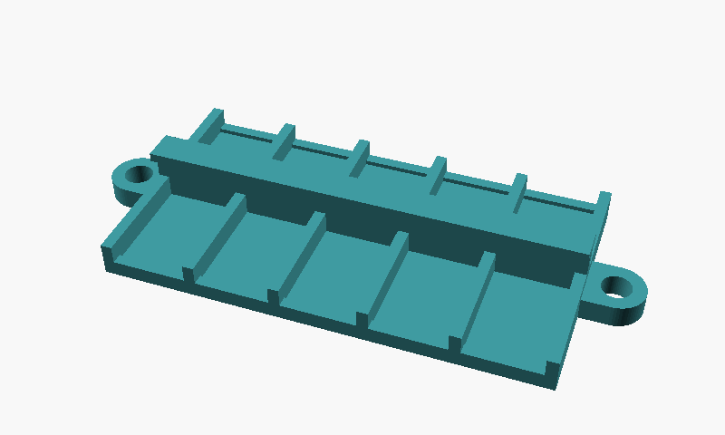
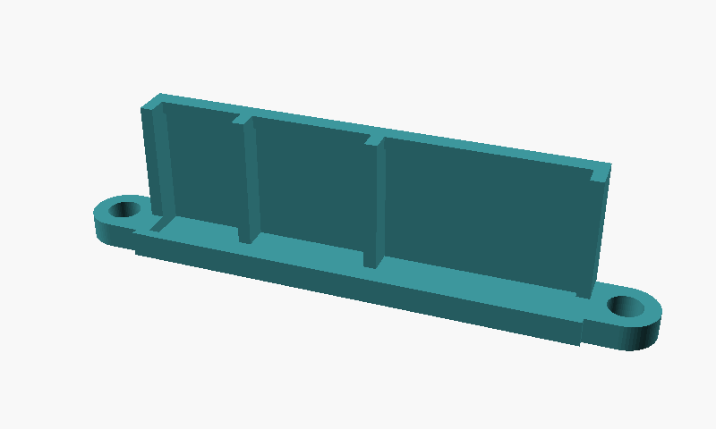

# lever-nut-holder-scad

A printable holder for WAGO 221 lever connectors, made in OpenSCAD. Each
connector sits in its own slot, held down by a lip over its back edge, with
the front left open for the wires and the levers free to open. Lay out any
mix of 2-, 3- and 5-conductor connectors in one row or two back to back,
lying flat or standing up, with a screw tab at each end.



## Use it

Open `lever_nut_holder.scad` in [OpenSCAD](https://openscad.org) and set the
parameters in the Customizer panel:

- **`blocks_config`:** one entry per slot, the number of conductors on the
  connector that goes in it: 2, 3 or 5 for the 221-412, 221-413 and 221-415.
  `[5, 3, 2]` is one of each.
- **`style_config`:**
  - `horizontal`: one row lying flat; the wires leave sideways.
  - `horizontal_mirrored`: two rows back to back, sharing the back wall.
  - `vertical`: one row standing on its back wall; the wires leave upward.
  - `vertical_mirrored`: two rows standing up, sharing the floor.
- **Screw tabs:** `tabs` turns them on or off; `tab_width`, `tab_radius` and
  `tab_height` set their size, the hole and their thickness. The default
  hole is 5.2 mm across.
- **`allowance`:** the clearance added to each connector's width, depth and
  height, 0.2 mm by default.



To use it from another design, put this folder in your OpenSCAD library
folder and call the module:

```scad
use <lever-nut-holder-scad/lever_nut_holder.scad>

lever_nut_holder(blocks = [5, 3, 2], style = "vertical", tabs = false);
```

`lever_nut_holder()` takes `blocks`, `style`, `tabs`, `tab_width`,
`tab_radius`, `tab_height` and `allowance`, with the same defaults as the
Customizer. It refuses an unknown style, an empty or fractional `blocks`, and
a screw hole as wide as its tab, with a message saying which.

## Fitting the connectors

Tip a connector's back edge under the lip, then press the front down past the
low front stop. To take it out, lift the front over the stop and slide it
forward.

The slots are sized from WAGO's datasheets: 18.6 mm deep, 8.3 mm high, and
13.1, 18.7 or 29.9 mm wide for 2, 3 or 5 conductors (5.6 mm a conductor, plus
1.9 mm). The lip sits `allowance` above the top of the connector. If the
connectors rattle, lower `allowance`; if they won't go in, raise it.

## Known limits

- **It hasn't been test-printed yet.** The checks below prove the slots clear
  a connector at datasheet size and that the lip reaches over it, not how it
  feels on a real 221 printed on a real printer, or whether the levers swing
  fully open under the lip.
- **Only the 221 series with levers on top.** The inline 221-2411 and the
  221-6xx connectors have other sizes.

## Checks

`just test` takes about 2 s. It renders each case with warnings treated as
errors:

- Every style, with tabs on and off, and four other layouts: one solid, of
  the size worked out by hand, sitting at the origin.
- Every style with five layouts:
  - **Fit:** where the holder meets connectors at datasheet size is empty.
  - **Grip:** where it meets connectors 1 mm taller is one piece of lip for
    each connector.
- The four refusals, each with its message.

`just images` renders the two pictures in this README. Written against
OpenSCAD 2026.10.15.

## Origin and licence

The holder is a rewrite, under MIT, of an idea from Joo Chung's
[WAGO 221 mounts](https://www.thingiverse.com/thing:2075219) on Thingiverse:
a row of slots for lever connectors with a screw tab at each end. The code
and the slot design are new, sized from WAGO's datasheets; the Customizer
parameters keep their names. This repository's earlier versions were
modifications of Joo Chung's design and are in its history; that design is
under CC BY-NC-SA 4.0. MIT; see [LICENSE](LICENSE).

WAGO is a trademark of WAGO GmbH & Co. KG. This project isn't affiliated
with WAGO.
